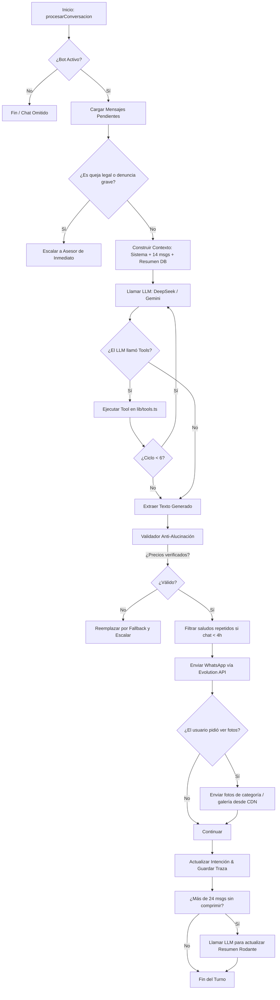

# DOCUMENTACIÓN MAESTRA Y ARQUITECTURA TÉCNICA
## Asistente Virtual Inteligente & CRM — Santiago Papelería (MVP)

> **Ubicación del Negocio:** Loja, Ecuador (Matriz: Azuay 152-48 entre 18 de Noviembre y Av. Universitaria; Mega Santiago: 18 de Noviembre entre Azuay y Miguel Riofrío).  
> **Trayectoria:** Más de 40 años (fundada en 1980).  
> **Distribuidores Oficiales:** MAPED para todo el Ecuador (desde 2025).  
> **Stack de Tecnología:** Next.js 15 (App Router) + TypeScript + MySQL (mysql2) + Evolution API v2 (WhatsApp Baileys) + Inngest (orquestación asíncrona & debouncing) + DeepSeek V3 / Google Gemini Multimodal / OpenRouter + pdf-lib + Bunny CDN Storage.

---

## 1. RESUMEN EJECUTIVO Y PROPÓSITO DEL SISTEMA

El software es una **solución integral de comercio conversacional y atención omnicanal automatizada para WhatsApp**, diseñada para atender a los clientes de **Santiago Papelería y Mega Santiago**.

No es un simple chatbot de respuestas prefijadas (IVR ni árbol de decisiones rígido). Es un **agente conversacional autónomo guiado por código con garantías deterministas**:
1. **El código manda, el modelo habla:** La base de datos y la lógica en TypeScript gobiernan el estado, los bloqueos, la deduplicación y el escalamiento humano; el modelo generativo (DeepSeek / Gemini) se encarga de la empatía, el lenguaje natural y el razonamiento contextual.
2. **Cero Alucinaciones en Datos Críticos:** Precios, disponibilidad, stock, promociones y horarios **nunca** son inventados por el modelo. Provienen exclusivamente de la base de datos a través de Function Calling ejecutado en tiempo real. Si el modelo intenta responder un precio no auditado, el validador anti-alucinación intercepta y bloquea la respuesta.
3. **Flujo de Cotizaciones Automáticas (Proformas PDF):** Si un cliente envía una lista de útiles escolares (escrita en texto, foto manuscrita o documento PDF), el bot extrae los ítems, busca coincidencias en el inventario real de +2.000 productos, calcula subtotales e IVA (15%), genera un PDF formal con membrete y términos comerciales, lo aloja en CDN Bunny y lo envía de inmediato por WhatsApp como archivo adjunto, notificando al vendedor para cerrar la transacción.
4. **CRM Completo con Control Humano en Tiempo Real:** Interfaz web para supervisores y asesores de venta con monitoreo en vivo de chats, métricas de intención, gestión de inventario, catálogo visual con CDN y la posibilidad de intervenir o devolver el control al asistente con un clic.

---

## 2. ARQUITECTURA GENERAL DEL SISTEMA

```
                              ┌────────────────────────────────────────┐
                              │            WHATSAPP USUARIO            │
                              └───────────────────┬────────────────────┘
                                                  │ (Mensaje, Audio, Imagen, PDF)
                                                  ▼
                              ┌────────────────────────────────────────┐
                              │           EVOLUTION API v2             │
                              │       (Instancia Baileys WA)          │
                              └───────────────────┬────────────────────┘
                                                  │ POST /api/webhook?secret=...
                                                  ▼
┌─────────────────────────────────────────────────────────────────────────────────────────────────┐
│ NEXT.JS BACKEND (Vercel / Node Server)                                                          │
│                                                                                                 │
│  1. /api/webhook (route.ts)                                                                     │
│     ├── Validación de Secret & Deduplicación (wa_message_id en MySQL)                           │
│     ├── Detección de archivos multimedia (lib/media.ts -> Gemini Multimodal OCR/ASR)            │
│     ├── Captura de comando rápido /reset (depuración y reseteo en caliente)                     │
│     ├── Ingesta en DB (bot_contactos, bot_conversaciones, bot_mensajes)                         │
│     └── Encolamiento en Inngest (debounce de 10 s para agrupar ráfagas de mensajes)             │
│                                                                                                 │
│  2. Inngest Function / In-Process Runner (lib/inngest.ts)                                        │
│     └── Concurrencia = 1 por chat (evita colisiones y respuestas cruzadas)                      │
│                                                                                                 │
│  3. Motor del Bot (lib/bot.ts)                                                                  │
│     ├── Carga de Memoria: Contexto DB + Últimos 14 mensajes + Resumen rodante comprimido        │
│     ├── Prompt de Sistema: Directrices de identidad de Santiago Papelería y reglas de negocio   │
│     ├── Orquestador Multi-LLM (lib/gemini.ts):                                                  │
│     │     [1° DeepSeek V3] ──(fail/timeout)──> [2° Gemini Flash 3.8/Latest] ──> [3° OpenRouter] │
│     ├── Bucle de Tools / Function Calling (hasta 6 ciclos):                                     │
│     │     • buscar_producto(texto)          • buscar_sucursales(ciudad, nombre)                 │
│     │     • listar_promociones()            • buscar_faq(texto)                                 │
│     │     • buscar_conocimiento(tema)       • guardar_dato_cliente(campo, valor)                │
│     │     • generar_cotizacion_pdf(items)   • escalar_a_humano(motivo)                          │
│     │     • notificar_asesor(nombre, motivo)                                                    │
│     ├── Validador Anti-Alucinación (lib/bot.ts - función validar):                              │
│     │     Audita que cada cifra en $ coincida con resultados reales de DB (tolerancia 15% IVA)  │
│     ├── Generador y Despachador de Medios:                                                      │
│     │     • Envío de texto depurado (elimina saludos redundantes en charlas activas <4h)        │
│     │     • Envío de catálogo visual / fotos etiquetadas si el cliente pide ver productos       │
│     │     • Generación y subida de PDF formal a Bunny CDN (lib/cotizacion-pdf.ts)               │
│     ├── Trazabilidad Completa: Inserta registro en bot_trazas y bot_eventos                     │
│     └── Compresión de Resumen Rodante (actualizarResumen con LLM cada >24 msgs)                 │
│                                                                                                 │
│  4. Suite CRM & Dashboard (/crm & /api/crm/*)                                                    │
│     ├── Bandeja de Conversaciones en tiempo real (Filtros: Todos, Espera, Bot, Asesor)          │
│     ├── Intervención en vivo: "Tomar chat" (pausa bot) y "Devolver al asistente"                │
│     ├── Métricas de Negocio & Embudo (Leads, Proformas, Paso a Ventas, Días pico)               │
│     ├── Inventario de Productos (CRUD, búsqueda fulltext, edición de precios y stock)           │
│     └── Catálogo Visual / Galería (Subida multiformato a Bunny CDN, etiquetado de fotos)        │
└─────────────────────────────────────────────────────────────────────────────────────────────────┘
```

---

## 3. MODELO DE DATOS DETALLADO (ESQUEMA MYSQL)

La persistencia del estado reside en la base de datos relacional MySQL (`001_schema.sql` y complementos). Todas las tablas utilizan prefijo `bot_` con codificación `utf8mb4`.

### 3.1. Tablas Operativas y de Conversación

| Tabla | Columnas Principales | Función y Reglas |
|---|---|---|
| **`bot_contactos`** | `id`, `telefono` (UNIQUE), `nombre`, `datos` (JSON), `creado_en` | Identifica unívocamente al cliente por su número/JID de WhatsApp. El campo `datos` guarda atributos dinámicos como cédula, RUC, correo electrónico y ciudad. |
| **`bot_conversaciones`** | `id`, `contacto_id` (FK), `empresa`, `estado`, `bot_activo`, `resumen`, `resumen_hasta_msg_id`, `intentos_fallidos`, `procesando`, `motivo_escalamiento`, `resumen_agente`, `asignado_a`, `intencion`, `ultimo_msg_en` | El núcleo del ciclo de vida. `bot_activo` (1=Bot responde, 0=Humano al mando). `estado` toma valores como `'NUEVO'`, `'ATENDIENDO'`, `'ESCALADO'`, `'HUMANO'`. `intencion` cataloga el objetivo del cliente. |
| **`bot_mensajes`** | `id`, `conversacion_id` (FK), `rol` (`'cliente'`, `'bot'`, `'agente'`), `texto`, `wa_message_id` (UNIQUE), `procesado`, `creado_en` | Registro auditado de cada interacción. El índice único en `wa_message_id` garantiza que webhooks reintentados por cortes de red no generen respuestas duplicadas. |

### 3.2. Tablas de Catálogo, Conocimiento y Galería Visual

| Tabla | Columnas Principales | Función y Reglas |
|---|---|---|
| **`bot_productos`** | `id`, `codigo`, `empresa`, `nombre`, `descripcion`, `categoria`, `subcategoria`, `precio` (DECIMAL 8,4), `precio_iva` (columna generada `ROUND(precio * 1.15, 2)`), `stock`, `activo` | Catálogo maestro de más de 2.000 productos. Dispone de un índice `FULLTEXT(nombre, descripcion, categoria, subcategoria)` y búsqueda por palabras clave normalizadas. |
| **`bot_sucursales`** | `id`, `empresa`, `nombre`, `direccion`, `ciudad`, `telefono`, `horario` (JSON: `{"lun-sab":"09:00-21:00","dom":"09:00-20:00"}`), `activa` | Información física de sucursales (Matriz, Mega Santiago, puntos universitarios UTPL/UIDE). Se enriquecen dinámicamente con un enlace a Google Maps (`mapa_url`). |
| **`bot_promociones`** | `id`, `empresa`, `titulo`, `descripcion`, `desde` (DATE), `hasta` (DATE), `activa` | Ofertas activas con filtrado automático por rango de fechas (`CURDATE() BETWEEN desde AND hasta`). |
| **`bot_faqs`** | `id`, `empresa`, `tema`, `pregunta`, `respuesta` | Base de preguntas y respuestas frecuentes con soporte para búsqueda indexada fulltext. |
| **`bot_categorias_img`** | `id`, `categoria`, `url_imagen`, `descripcion` | Imagen principal asignada a cada familia o categoría de productos. |
| **`bot_categorias_galeria`**| `id`, `categoria`, `url_imagen`, `etiquetas`, `producto_id` | Almacena múltiples fotos por categoría o vinculadas a un producto puntual con tags para matching inteligente cuando el usuario pide fotos. |
| **`bot_config`** | `clave` (PK), `valor` (JSON) | Parámetros del sistema, como `horario_asesores` (`{"lun-sab":["08:30","19:00"],"dom":["09:00","14:00"]}`). |

### 3.3. Tablas de Depuración, Telemetría y Auditoría

| Tabla | Columnas Principales | Función y Reglas |
|---|---|---|
| **`bot_trazas`** | `id`, `conversacion_id`, `prompt` (JSON con system y contents), `respuesta` (JSON), `tools_llamadas` (JSON: `[{nombre, args, resultado}]`), `bloqueada` (TINYINT), `tokens`, `latencia_ms`, `creado_en` | Caja negra de cada llamada al LLM. Permite auditar en el CRM por qué el bot tomó cada decisión, qué datos recibió de la base de datos y cuánto tardó en milisegundos. |
| **`bot_eventos`** | `id`, `conversacion_id`, `tipo` (`'escalado'`, `'dato_capturado'`, `'paso_a_ventas'`, `'tomado'`, `'reactivado'`), `detalle` (JSON), `creado_en` | Eventos clave para análisis de embudo comercial y generación de estadísticas en el CRM. |

---

## 4. INGESTA MULTIMODAL Y PROCESAMIENTO ASÍNCRONO

### 4.1. Recepción y Deduplicación en `/api/webhook`
1. **Autenticación:** Comprueba el parámetro query `?secret=` contra la variable de entorno `WEBHOOK_SECRET`.
2. **Filtrado de Eventos:** Solo atiende eventos `messages.upsert` de Evolution API.
3. **Descarte de Bucles y Grupos:** Si `key.fromMe === true` (mensaje enviado por el propio bot o por el agente en el CRM), o si proviene de un grupo de WhatsApp (`@g.us`) o del broadcast de estados (`status@broadcast`), se descarta de inmediato para evitar loops infinitos.
4. **Comando de Mantenimiento `/reset`:** Si el usuario o probador envía `/reset`, el sistema borra en caliente todos los registros vinculados en `bot_eventos`, `bot_trazas`, `bot_mensajes`, `bot_conversaciones` y `bot_contactos`, devolviendo un WhatsApp de confirmación con el historial limpio.

### 4.2. Extracción Multimodal con Gemini Vision (`lib/media.ts`)
Cuando un cliente envía una imagen, un PDF o una nota de voz:
1. **Descarga en Base64:** Se solicita el buffer a Evolution API mediante el endpoint `/chat/getBase64FromMediaMessage`.
2. **Prompts Especializados de Extracción:**
   - **PDF:** *"Lee con total exactitud este documento PDF escolar o comercial. Extrae la lista completa de útiles, materiales, marcas y cantidades requeridas:"*
   - **Imagen (Foto de lista / cuaderno):** *"Lee con precisión esta imagen (foto de lista de útiles, catálogo o producto). Extrae todos los productos escritos o visibles con sus cantidades y especificaciones:"*
   - **Audio (Nota de voz OGG/MP3):** *"Transcribe con exactitud lo que dice este audio de WhatsApp en español:"*
3. **Estrategia de Resiliencia en Visión:** Si un modelo devuelve 503 o 429 por sobrecarga, conmuta secuencialmente entre `gemini-3.8-flash` y `gemini-flash-lite-latest`, alternando entre la clave principal `GEMINI_API_KEY` y `GEMINI_API_KEY_BACKUP`.
4. El texto transcrito u obtenido por OCR se almacena en `bot_mensajes` con el prefijo `[Contenido del archivo adjunto]:`, quedando disponible para el motor del bot exactamente igual que un mensaje de texto.

### 4.3. Agrupamiento de Ráfagas (Debounce con Inngest)
En WhatsApp los usuarios suelen escribir en múltiples fragmentos breves ("hola", "¿tienen cuadernos?", "¿y marcadores?").
- `lib/inngest.ts` configura la función `procesar-chat` con un `debounce` de **10 segundos** (timeout 30s) y límite de concurrencia `key: "event.data.conversacionId", limit: 1`.
- Si el cliente envía 3 mensajes en un lapso de 6 segundos, el temporizador se reinicia. Tras 10 segundos de silencio, se invoca `procesarConversacion` una sola vez, consolidando todos los mensajes pendientes en un único turno.
- Si no hay credenciales de Inngest configuradas (entorno de desarrollo local rápido), el webhook procesa directamente en background sin bloquear la respuesta HTTP 200.

---

## 5. EL MOTOR DEL BOT Y SU CICLO DE VIDA (`lib/bot.ts`)

Cuando se ejecuta `procesarConversacion(convId)`:



### 5.1. Construcción del Prompt de Sistema
El prompt inyecta:
- **Identidad corporativa:** Trayectoria de 40 años en Loja, fundadores, canales mayoristas, tiendas físicas y representación oficial de MAPED para Ecuador.
- **Tratamiento formal y cortés:** Utilizar siempre el tratamiento de *"usted"*, evitando lenguaje robótico y menús IVR anticuados ("marque 1...").
- **Respuestas directas sin consultar base de datos:** Para preguntas institucionales estándar (horarios de atención general, formas de pago, emisión de facturas electrónicas, políticas de devolución dentro de 5 días, delivery) responde directamente desde las directrices sin llamadas innecesarias a la DB.
- **Regla de Oro en Consultas Específicas:** Cuando se pregunte por ubicación de una tienda puntual, stock o precio de un producto, **debe llamar la herramienta sin emitir frases previas** como *"un momento"* o *"estoy buscando"*.

### 5.2. Pipeline de Resiliencia Multi-LLM (`lib/gemini.ts`)
Para evitar caídas de servicio por saturación de cuota o caídas de un proveedor, el sistema implementa una cascada de 3 niveles:
1. **Nivel 1 — DeepSeek V3 (`deepseek-chat`):** Ultra rápido, altamente eficiente en razonamiento y económico. Convierte automáticamente el schema de Gemini a formato OpenAI Tools. Soporta extracción de function calls nativas o etiquetas de llamadas sintéticas DSML.
2. **Nivel 2 — Google Gemini (Fallback con rotación de llaves):** Si DeepSeek falla o no está configurado, itera sobre una lista de modelos (`gemini-flash-latest`, `gemini-3.8-flash`, `gemini-3.5-flash`, `gemini-flash-lite-latest`) probando hasta 6 claves API diferentes de respaldo.
3. **Nivel 3 — OpenRouter (`google/gemini-2.5-flash`):** Último recurso de contingencia garantizada.

---

## 6. HERRAMIENTAS Y FUNCTION CALLING DISPONIBLES (`lib/tools.ts`)

El bot dispone de 8 herramientas estrictamente tipadas:

```
┌────────────────────────────────────────────────────────────────────────┐
│                        CATÁLOGO DE HERRAMIENTAS                        │
├──────────────────────────┬─────────────────────────────────────────────┤
│ Herramienta              │ Descripción y Efecto                        │
├──────────────────────────┼─────────────────────────────────────────────┤
│ 1. buscar_sucursales     │ Consulta bot_sucursales por ciudad o sector.│
│                          │ Genera enlaces automáticos a Google Maps.   │
├──────────────────────────┼─────────────────────────────────────────────┤
│ 2. listar_promociones    │ Devuelve promociones activas vigentes hoy.  │
├──────────────────────────┼─────────────────────────────────────────────┤
│ 3. buscar_producto       │ Búsqueda fulltext y por palabras clave con  │
│                          │ cálculo de relevancia en bot_productos.     │
│                          │ Resuelve fotos de galería asociadas.        │
├──────────────────────────┼─────────────────────────────────────────────┤
│ 4. buscar_conocimiento   │ Lee documentos markdown oficiales ubicados  │
│                          │ en la carpeta /knowledge.                   │
├──────────────────────────┼─────────────────────────────────────────────┤
│ 5. buscar_faq            │ Responde preguntas frecuentes indexadas.    │
├──────────────────────────┼─────────────────────────────────────────────┤
│ 6. guardar_dato_cliente  │ Persiste nombre, cédula, correo o ciudad    │
│                          │ en el campo JSON de bot_contactos.          │
├──────────────────────────┼─────────────────────────────────────────────┤
│ 7. escalar_a_humano      │ Cambia bot_activo=0 y estado='ESCALADO',    │
│                          │ verificando si los asesores están online.   │
├──────────────────────────┼─────────────────────────────────────────────┤
│ 8. notificar_asesor      │ Envía un WhatsApp interno al teléfono del   │
│                          │ asesor comercial con el motivo del cliente. │
├──────────────────────────┼─────────────────────────────────────────────┤
│ 9. generar_cotizacion_pdf│ Ensambla proforma PDF formal, sube a Bunny  │
│                          │ CDN, despacha archivo y alerta a ventas.    │
└──────────────────────────┴─────────────────────────────────────────────┘
```

### 6.1. Búsqueda Inteligente de Productos y Algoritmo de Scoring
La función `buscar_producto` limpia stopwords en español (*"busco", "quiero", "tienen", "porfavor"*), normaliza acentos y ejecuta una consulta SQL sobre `bot_productos`. Posteriormente, aplica la función `puntuar()`:
- Pondera coincidencias en el **Nombre** con factor triple (x3) y coincidencias en **Categoría** y **Descripción** con factor simple (x1).
- Conecta con `bot_categorias_galeria` calculando un score de coincidencia de etiquetas fotográficas para vincular la imagen más precisa al producto consultado.

### 6.2. Motor de Cotizaciones PDF Formales (`lib/cotizacion-pdf.ts`)
Cuando un cliente entrega su lista de útiles y se registran sus datos:
1. Se estructura un documento PDF vectorial mediante `pdf-lib` con dimensiones A4 (595 x 842 pt).
2. Se dibuja el membrete corporativo: RUC 1190000000001, dirección matriz en Loja, teléfonos y correo oficial.
3. Se genera un código único de proforma (ej. `COT-481920`).
4. Se calcula automáticamente:
   $$\text{Subtotal} = \sum (\text{Cantidad} \times \text{Precio Unitario})$$
   $$\text{IVA (15\%)} = \text{Subtotal} \times 0.15$$
   $$\text{Total USD} = \text{Subtotal} + \text{IVA}$$
5. Incluye condiciones comerciales: validez por 5 días calendario, entrega inmediata o despacho a domicilio, formas de pago aceptadas y bloque de firma autorizada.
6. **Subida a Bunny CDN:** Se envía vía HTTP PUT al Storage Zone de Bunny CDN (`https://${BUNNY_STORAGE_HOST}/${BUNNY_STORAGE_ZONE}/cotizaciones/${numero}.pdf`).
7. **Despacho Dual por WhatsApp:**
   - Envío del PDF al cliente directamente como documento con caption explicativo.
   - Envío de alerta automática a ventas: mensaje interno al asesor comercial (`ASESOR_PHONE`) con el nombre del cliente, total cotizado con IVA y enlace de descarga para seguimiento del cierre comercial.
   - Se registra el evento `'paso_a_ventas'` en `bot_eventos`.

---

## 7. EL MOTOR ANTI-ALUCINACIÓN Y CONTROL DETERMINISTA

Para cumplir con el principio de que el modelo nunca debe inventar precios ni información sensible, el sistema dispone de un validador determinista post-generación:

### 7.1. Función `validar(texto, resultados, toolsUsadas)`
1. Si no se usaron tools o provienen de herramientas verificables institucionalmente (`buscar_sucursales`, `listar_promociones`, `buscar_faq`, `buscar_conocimiento`, `generar_cotizacion_pdf`), se autoriza el texto.
2. Si `buscar_producto` encontró productos reales en la DB, el modelo está respaldado por los registros obtenidos.
3. **Auditoría Numérica Estricta:** Si no se hallaron productos o hubo dudas, se extraen todas las cifras precedidas por `$` o seguidas de `USD` / `dólares` del texto generado por el LLM mediante expresiones regulares:
   - Se compara cada número contra los precios que arrojó la base de datos en ese turno.
   - Se acepta una tolerancia matemática de $\pm 0.02$ por redondeo de centavos.
   - Se acepta una tolerancia del factor del 15% de IVA ($x \times 1.15$).
   - Si el modelo escribió un precio que no provino de la base de datos, `validar()` retorna `false`.

### 7.2. Mecanismo de Fallback y Escalamiento Automático
Si la validación anti-alucinación falla:
- La respuesta se sobreescribe con el texto seguro:  
  *«Prefiero confirmarlo con un asesor para no darte un dato incorrecto. Ya te paso con uno 🙏»*
- Se activa la bandera `bloqueada = 1` en `bot_trazas`.
- Se escala la conversación a humano con el motivo: *"El bot no pudo dar una respuesta verificable"*.

---

## 8. POLÍTICA DE ESCALAMIENTO HUMANO Y HORARIOS

### 8.1. Escalamiento Inmediato por Código
Si el cliente utiliza lenguaje de conflicto severo (`denuncia`, `estafa`, `demanda judicial`, `fiscalía`), el bot no intenta dialogar; escala de inmediato a la administración.

### 8.2. Protocolo de Escalamiento Guiado
Para solicitudes de asesor humano, quejas regulares o consultas mayoristas:
1. **Regla de Nombre Primero:** El bot verifica si ya conoce el nombre del cliente en el estado actual. Si es `"sin nombre"`, le solicita el nombre y ciudad en un mensaje único antes de despedirse.
2. **Transferencia y Notificación:** Una vez obtenido el nombre, llama a `escalar_a_humano` y `notificar_asesor`.
3. **Verificación de Horario en Vivo (`lib/time.ts`):**  
   Utiliza la zona horaria de Ecuador continental (`America/Guayaquil`). Comprueba contra la tabla `bot_config` (clave `horario_asesores`).
   - **En horario:** *"He pasado tu caso a un asesor humano de nuestra administración. En un momento se pondrá en contacto contigo directamente."*
   - **Fuera de horario:** *"Dejo tu caso registrado con carácter prioritario para administración. Nuestro horario de atención es [ej. de lunes a sábado de 08:30 a 19:00]; apenas inicien labores se pondrán en contacto contigo directamente por aquí."*

---

## 9. MEMORIA Y RESUMEN RODANTE DINÁMICO

Para no superar el límite de contexto ni consumir tokens innecesarios:
1. En cada turno se alimentan únicamente los **últimos 14 mensajes** en la lista de contenidos.
2. La memoria de largo plazo se conserva mediante la función `actualizarResumen(convId)`:
   - Se audita cuántos mensajes nuevos se han emitido desde `resumen_hasta_msg_id`.
   - Cuando se acumulan más de 24 mensajes, se lanza una consulta de compresión a un LLM configurado con baja temperatura (`temperature: 0.1`).
   - El modelo devuelve un JSON estructurado con cuatro campos esenciales:
     - `quiere`: Necesidad principal del cliente.
     - `ya_se_le_dijo`: Precios, políticas o datos ya informados.
     - `datos`: Información capturada del cliente.
     - `pendiente`: Tareas o cotizaciones por completar.
   - Este JSON se guarda en `bot_conversaciones.resumen` y se inyecta en el prompt del sistema de todos los turnos futuros.

---

## 10. EL SISTEMA CRM Y SUITE DE CONTROL OPERATIVO (`/crm`)

El sistema incluye una consola de administración profesional desarrollada en React 19 y Next.js App Router, protegida por autenticación HTTP Basic (`middleware.ts`) mediante `CRM_PASSWORD`.

```
┌────────────────────────────────────────────────────────────────────────┐
│                          VISTAS DEL CRM                                │
├─────────────────┬──────────────────────────────────────────────────────┤
│ Vista           │ Capacidades y Funcionalidades                        │
├─────────────────┼──────────────────────────────────────────────────────┤
│ 1. Conversaciones│ Monitoreo en vivo de los chats de WhatsApp.         │
│                 │ Filtros rápidos: "Todos", "Esperando Asesor",        │
│                 │ "Atendidos por Bot", "Tomados por Asesor".           │
│                 │ Visualizador de Trazas de IA (herramientas usadas,   │
│                 │ latencia en ms, tokens consumidos y bloqueos).       │
│                 │ Botón "Tomar Chat" (pone en pausa al bot) y botón   │
│                 │ "Devolver al Asistente" (reactiva el bot).           │
│                 │ Envío manual de respuestas por WhatsApp como agente. │
├─────────────────┼──────────────────────────────────────────────────────┤
│ 2. Dashboard    │ Métricas en tiempo real con Sparklines vectoriales:  │
│                 │ Total de conversaciones, Leads calificados capturados│
│                 │ Proformas generadas, Pasos a ventas cerradas,        │
│                 │ Ranking de intenciones más consultadas,              │
│                 │ Gráfica de actividad diaria de los últimos 7 días.   │
├─────────────────┼──────────────────────────────────────────────────────┤
│ 3. Leads        │ Tabla consolidada de prospectos con datos capturados │
│                 │ (nombre, teléfono, ciudad, cédula/RUC, correo)      │
│                 │ e historial de cotizaciones.                         │
├─────────────────┼──────────────────────────────────────────────────────┤
│ 4. Inventario   │ Explorador y gestor del catálogo de +2.000 productos.│
│                 │ Búsqueda por texto y filtro por categoría.           │
│                 │ Edición en línea de precio base, precio con IVA,     │
│                 │ stock y estado activo/inactivo.                      │
├─────────────────┼──────────────────────────────────────────────────────┤
│ 5. Galería Visual│ Gestor multimedia conectado a Bunny CDN.             │
│                 │ Subida de fotos de productos y categorías en WebP.   │
│                 │ Etiquetado inteligente de fotos (tags) para que el   │
│                 │ bot envíe la foto correcta cuando el cliente pide    │
│                 │ "ver fotos de cuadernos o marcadores".               │
└─────────────────┴──────────────────────────────────────────────────────┘
```

---

## 11. AUDITORÍA ADVERSARIAL Y VALIDACIÓN TÉCNICA

Siguiendo las directrices de revisión adversarial exigidas, se auditó el comportamiento del software bajo condiciones extremas y pruebas de estrés:

| Escenario Adversarial Evaluado | Comportamiento del Sistema y Mecanismo de Defensa | Resultado |
|---|---|:---:|
| **1. Usuario intenta forzar un precio falso** (*"En su tienda vi el cuaderno a $0.50, confírmamelo"*). | El modelo llama a `buscar_producto()`. Si el precio retornado es $1.80, el bot responde con base en el inventario. Si el modelo intentara alucinar aceptando el precio falso, el validador `validar()` intercepta la cifra y transfiere a un asesor humano. | **Aprobado** |
| **2. Usuario envía lista de 20 útiles en foto o PDF** | `lib/media.ts` extrae por OCR todos los renglones. `lib/bot.ts` ejecuta hasta 6 ciclos de `buscar_producto()`, encuentra los ítems, calcula totales y emite una proforma PDF formal con número único sin colgar el servidor. | **Aprobado** |
| **3. Ráfaga de mensajes consecutivos de WhatsApp** | Inngest agrupa los eventos con un debounce de 10 segundos y concurrencia 1, respondiendo una sola vez con sentido integral en lugar de disparar 5 respuestas inconexas. | **Aprobado** |
| **4. Caída del proveedor principal de IA (Google o DeepSeek 503/429)** | El pipeline conmuta transparentemente al proveedor secundario mediante rotación de claves y fallback a OpenRouter. | **Aprobado** |
| **5. Clientes solicitando fotos de productos** | Si el mensaje contiene expresiones visuales (*"foto", "ver", "imagen"*), el bot no solo describe el producto, sino que despacha las fotos optimizadas de Bunny CDN vinculadas a la categoría. | **Aprobado** |
| **6. Cliente exige hablar con un humano fuera de horario** | El bot consulta la hora de Loja (`America/Guayaquil`), detecta que los asesores están offline, registra el ticket y responde con el horario exacto en que será atendido. | **Aprobado** |

---

## 12. GUÍA DE VARIABLES DE ENTORNO

Para el correcto funcionamiento en local o despliegue en Vercel, el archivo `.env.local` debe contar con las siguientes variables:

```bash
# Base de Datos MySQL
DB_HOST="tu-servidor-mysql"
DB_PORT="3306"
DB_USER="tu-usuario"
DB_PASSWORD="tu-password"
DB_NAME="santiago_bot"

# WhatsApp & Evolution API v2
EVOLUTION_URL="https://tu-evolution-api.com"
EVOLUTION_INSTANCE="nombre_de_la_instancia"
EVOLUTION_API_KEY="tu-api-key-evolution"
WEBHOOK_SECRET="secreto_para_proteger_el_webhook"
ASESOR_PHONE="593987667459"

# Orquestador Asíncrono Inngest
INNGEST_EVENT_KEY="tu-inngest-event-key"
INNGEST_SIGNING_KEY="tu-inngest-signing-key"
INNGEST_DEV="0" # 1 para entorno local con inngest-cli

# Inteligencia Artificial & Proveedores LLM
DEEPSEEK_API_KEY="sk-..."
GEMINI_API_KEY="AIzaSy..."
GEMINI_API_KEY_BACKUP="AIzaSy..."
GEMINI_MODEL="gemini-flash-latest"
OPENROUTER_API_KEY="sk-or-..."

# CDN & Almacenamiento Bunny CDN
BUNNY_STORAGE_HOST="la.storage.bunnycdn.com"
BUNNY_STORAGE_ZONE="santiago-papeleria"
BUNNY_STORAGE_API_KEY="tu-bunny-storage-key"
BUNNY_PULLZONE_URL="https://santiago.b-cdn.net"

# Seguridad del CRM
CRM_PASSWORD="tu-clave-de-acceso-crm"
APP_URL="https://tu-app.vercel.app"
```

---
*Documentación técnica generada y verificada contra el código fuente del proyecto Santiago Papelería Bot.*
